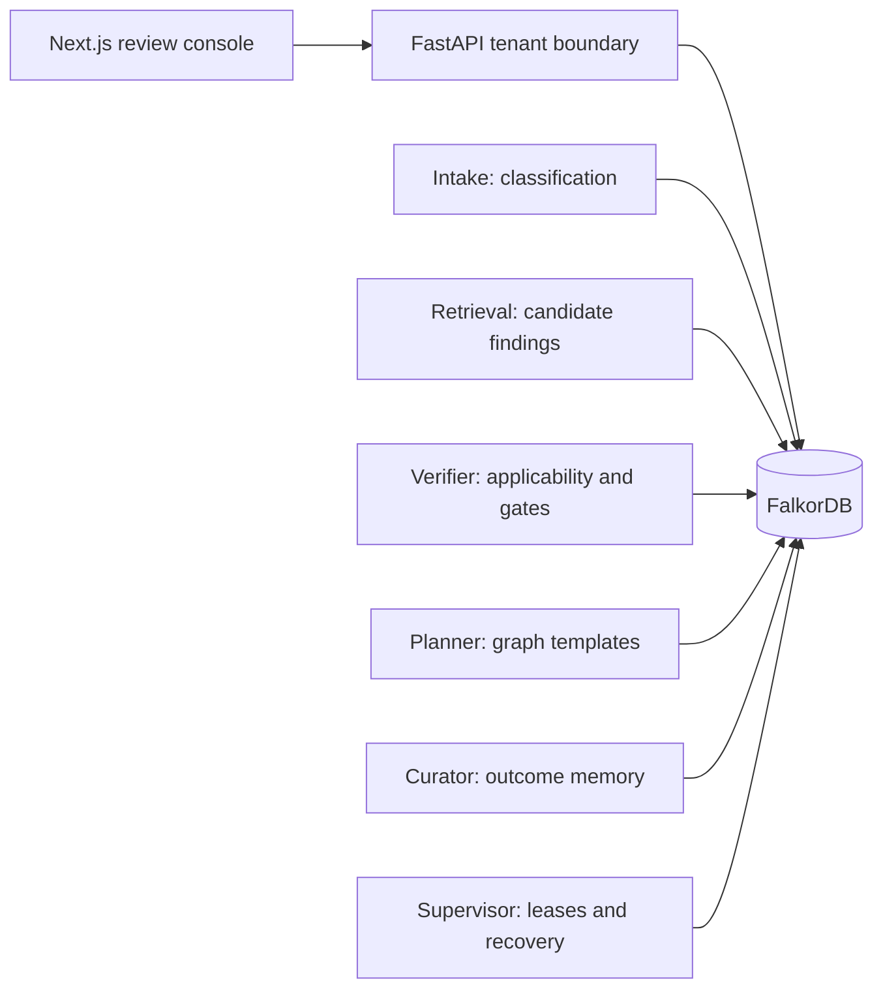
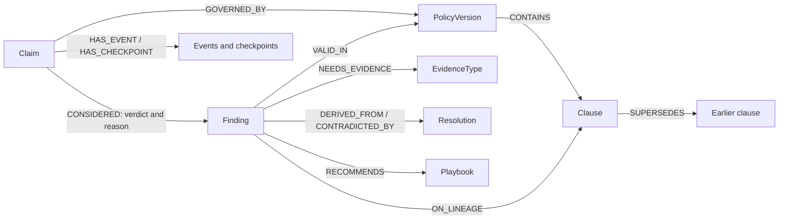

# ClaimBridge

A review workspace for denied health-insurance claims, with versioned memory and five workers coordinating through **FalkorDB**. A past win can inform the next checklist, but only when its policy version, clause and conditions still apply.

Built for **Graph Hacks**. Tracks entered: **Track 02, Agent Memory and Coordination (primary)** and **Track 01, Agents That Act on Connected Data**. All insurers, policies, people and outcomes are fictional. This is a bounded research prototype, not a coverage decision service.

**Demo video:** [youtu.be/dky01tNoJX0](https://youtu.be/dky01tNoJX0)

## Tracks entered

**Track 02 (primary): Agent Memory and Coordination.** Episodic memory is the per-claim event log and checkpoints; semantic memory is the versioned Findings (`VALID_IN`, `STALE_BECAUSE`); procedural memory is the playbooks counted from verified outcomes; shared state and handoffs are the claim status, leases and fenced commits; per-tenant memory is the tenant boundary. Evidence for each is in [docs/14-track-assessment.md](docs/14-track-assessment.md).

**Track 01: Agents That Act on Connected Data.** Where each focus item lives:

| Focus item | Delivered by | Check it |
|---|---|---|
| Multi-hop reasoning | claim → policy version → clause lineage → precedent, walked hop by hop; first broken edge marked ([trace.py](backend/claimbridge/tools/trace.py)) | `tests/test_trace.py`; Case → *Show the path through the graph* |
| Graph queries and algorithms as agent tools | one read-only catalogue of 8 tools ([catalogue.py](backend/claimbridge/catalogue.py)), including `policy_blast_radius`, which runs FalkorDB `algo.BFS` and `algo.pageRank` ([blast.py](backend/claimbridge/tools/blast.py)); the investigator agent picks from it ([investigator.py](backend/claimbridge/investigator.py)) | `tests/test_blast.py`, `tests/test_investigator.py`; Case → *Investigate*; Memory → *Which clauses carry the most memory* |
| Tool selection through MCP | the same catalogue served over MCP stdio ([mcp_server.py](backend/claimbridge/mcp_server.py)); the connected client's model chooses the tools | `tests/test_catalogue_mcp.py`; [Use it from an MCP client](#use-it-from-an-mcp-client) |
| Actions based on what the graph shows | the five workers act on graph state (status, leases, the Verifier's verdicts), and every decision waits at the human gate; the investigator is read-only apart from storing its own trace | `tests/test_coordination.py`, `tests/test_investigator.py` (guard, no state change) |
| Explainable results | citation guard on advice, edge-by-edge paths, and an investigation brief whose every id and number must appear in a tool result of the same run | Case → *Investigate* (each step expands to its raw result) |

Honest scope: the investigator **cannot** change a claim, a precedent or a disposition, and it has no action tool. Decisions stay with the Verifier, the Planner and a person. That is a design choice, so "actions" is only partly met in the sense Track 01 means.

## Run locally

Prerequisites: Docker Desktop with Compose, internet for the first image/model download, and about 6 GB of free RAM. Ports 3100, 8000, 6379 and 3000 must be free; every one is bound to localhost and can be moved with `WEB_PORT`, `API_PORT`, `DB_PORT`, `DB_UI_PORT` in `.env`. The database image is pinned (FalkorDB 4.22.1), the version every test and result here ran on.

```bash
cp .env.example .env
docker compose --profile app up -d --build
```

PowerShell: use `Copy-Item .env.example .env`. Open **http://localhost:3100**, then **Open console**. FalkorDB Browser: http://localhost:3000. API docs: http://localhost:8000/docs.

Bundled synthetic notices replay recorded Groq responses. Set `GROQ_API_KEY` in `.env` to classify new notices. With no matching recording and no provider, intake asks for human review; it does not guess from similarity. The planner publishes graph templates without an LLM call. The **investigator** needs a key (or a recorded run in `data/llm_cache`) to let a model choose tools; with neither, *Investigate* runs the same tools in a fixed order and the panel says **Graph-only (LLM unavailable)**. `PLANNER_DRAFT_AUDIT=1` optionally audits model drafts without publishing arbitrary model prose.

**Demo mode is deliberately public:** every visitor can inspect fictional cases and exercise operator controls. Do not load private records. Compose startup runs a seed service that resets the configured demo graph. To stop without removing data: `docker compose --profile app down`.

Troubleshooting: `docker compose --profile app logs --tail=80 seed api agents web`. The first seed downloads an embedding model and can take several minutes. Rebuild only the UI without resetting: `docker compose --profile app up -d --build --no-deps web`.

## Try the core claims

1. File **T1** from the Docket. Open `EV-T1-01`: the 2025 MRI precedent is rejected because the 2026 clause governs. Inspect the graph, citations and agent record.
2. File `EV-M-B1` and `EV-M-A` individually. Open A, approve for review, record **OVERTURNED**, and confirm **Emergency attestation + Itemized bill** were used. Wait for CURATED. Then file `EV-M-B2`: its checklist asks the reviewer about the missing bill and cites the learned Finding. After one observed win, support is 0.667, not an approval probability.
3. In Memory, rewind to 2025 and publish 2026. Changed clause fingerprints invalidate dependent memory; unchanged clauses carry forward. Rewind resets the demo graph.
4. File a group, open Agents and kill a worker while it holds a lease. Its replacement resumes from graph state. The evaluation also runs reproducible fault injection.
5. Download a **review packet** from a completed case: cited plan, clause, precedent decisions, uncertainty and audit events. Approval and download do not submit anything to an insurer.
6. Click **New claim** on the Docket, pick *Insert* for a sample notice and **File and watch**: the graph replay plays as the agents work your claim. Change the section number to one that does not exist and file again: Intake stops and says why instead of guessing.
7. On any precedent in a case, choose **Show the path through the graph**: the edges it needs are checked one by one and the first broken one is marked. On Memory, **What rests on a clause** traverses a clause, its precedents, their evidence and the claims that weighed them. It is sparse on a fresh graph: on the Docket, use *File a group* (Normal, then each trap group, but not the `EV-M-*` memory pair) first, so every lineage has claims on it.
8. On a claim that needs a person, choose the denial reason and give a reason: the original notice stays untouched, the claim resumes at Retrieval and nothing computed before is kept. In **Evidence**, declare a document on file: the plan is withdrawn and re-checked. A document is *declared, never verified*.
9. On any case, open **Investigate**. *Investigate* lets the model choose graph tools (needs a Groq key or a recorded run); *Graph-only run* calls the same tools in a fixed order and says so. Each step is a plain sentence you can expand to the raw tool result, and the brief is checked against those results.
10. On Memory, **Which clauses carry the most memory** ranks clause lineages with FalkorDB's PageRank and shows, with BFS, what one clause change would reach and how many hops away.

## Use it from an MCP client

The read-only graph tools are available over the Model Context Protocol (stdio), so any MCP client's own model can choose among them. The server runs as **one tenant fixed at start** (`CLAIMBRIDGE_MCP_TENANT`, default `TEN-01`), reads its **own graph** (`CLAIMBRIDGE_MCP_GRAPH`, default `claimbridge`) on the FalkorDB at `FALKORDB_HOST`/`FALKORDB_PORT`, exposes no write tool, and never lets a tool argument name a tenant: another tenant's claim looks exactly like a claim that does not exist. It uses no LLM; the client's model does the choosing.

Start the database and the demo graph first (`docker compose --profile app up -d --build`), then:

```bash
cd backend && uv run python -m claimbridge.cli mcp                         # stdio server
npx @modelcontextprotocol/inspector uv run --directory backend python -m claimbridge.cli mcp   # try it in the Inspector
docker compose run --rm -T --quiet-build mcp                                              # the same server in a container
```

Claude Desktop (`claude_desktop_config.json`; use your own path):

```json
{
  "mcpServers": {
    "claimbridge": {
      "command": "uv",
      "args": ["run", "--directory", "C:/path/to/claimbridge/backend", "python", "-m", "claimbridge.cli", "mcp"],
      "env": {"CLAIMBRIDGE_MCP_TENANT": "TEN-01", "CLAIMBRIDGE_MCP_GRAPH": "claimbridge", "FALKORDB_HOST": "localhost", "FALKORDB_PORT": "6379"}
    }
  }
}
```

A client that starts the server with a stripped-down environment (some do) cannot launch `docker`; prefer the `uv` command in that case.

Tools: `get_claim`, `select_version`, `find_candidates`, `check_applicability`, `evidence_gap`, `explain_path`, `what_rests_on_clause`, `policy_blast_radius`. Questions to try (after filing **EV-T1-01** so it has been classified and checked):

1. *Why was the 2025 MRI precedent rejected for EV-T1-01?* (the client should call `check_applicability` and `explain_path`)
2. *What evidence is still missing on EV-T1-01, and which clause requires it?* (`evidence_gap`)
3. *If clause C-2026-MRI-PREAUTH changes again, what is affected and how far away is it?* (`policy_blast_radius`)

## Architecture and graph model





The graph selects the service-date policy, evaluates applicability, computes evidence gaps, stores memory, claims leases and fences writes. Removing FalkorDB prevents the pipeline from operating. The five roles are bounded workflow workers; they do not negotiate or choose arbitrary tools. The separate **investigator** does choose tools, but only from a read-only catalogue, and it cannot write a decision (see [Tracks entered](#tracks-entered)).

**Executable queries:** [verification](backend/claimbridge/tools/applicability.py), [evidence and sources](backend/claimbridge/tools/evidence.py), [memory and invalidation](backend/claimbridge/tools/memory.py), [leases and checkpoints](backend/claimbridge/tools/coordination.py), [tenant precedents](backend/claimbridge/tools/tenancy.py). See the [query walkthrough](docs/05-cypher-queries.md) and [full model](docs/02-data-model.md).

### Why a graph, not just Postgres or NetworkX

The state lives in the database and changes while agents act: a claim's status, its lease and its fenced commits are the coordination, so there is no queue and no agent-to-agent messaging to keep consistent. Several writers share it safely because every write checks the lease inside the same query. Memory validity is a traversal (`VALID_IN`, `SUPERSEDES`), the algorithms run where the data is, and the tools are exposed over MCP against that same store. A relational schema could hold this data, and NetworkX could run `BFS` on an export; the point here is one live store that coordinates, remembers and answers. The data is small and synthetic, so this demonstrates the architecture, not scale.

## Verification and evaluation

```bash
docker compose up -d falkordb
cd backend && uv sync --frozen && uv run pytest -q          # real FalkorDB, fake LLM
cd ../web && npm install && npm run lint && npm test && npm run build && npx tsc --noEmit   # build first: it generates the route types tsc needs
node scripts/browser-smoke.mjs                              # real Chrome: drives the running demo stack
node scripts/access-matrix.mjs                              # real Chrome: its OWN isolated protected stack
```

Tests use `claimbridge_test`, real FalkorDB and a fake LLM. They cover applicability, races, a living worker paused past its lease, a Curator interrupted after every statement, a policy published mid-flight, credential and tenant boundaries over real HTTP, the event stream's lifetime, intake escalation, memory under duplicate and contradicting outcomes, the human correction and evidence flows, and the evaluation's own bookkeeping. The access matrix signs in, reloads, signs out, switches identity and revokes a credential in a real browser. CI runs backend tests, frontend lint, type checking, unit tests and a production build; it has not been run on a remote runner from this workspace.

Reproduce the benchmark from `backend` with `GRAPH=claimbridge_eval uv run python -m claimbridge.cli eval all --label <name>` (the CLI refuses the demo graph, because an evaluation resets its graph). Every run is its own directory in `eval/runs/<run_id>/` with its code, data and prompt digests, model, cache policy, timestamps, a per-call ledger and never-overwritten raw predictions; a run whose code changed mid-run is marked invalid, and `eval promote --run <id>` refuses one. The promoted run is [eval/results/latest.md](eval/results/latest.md), with [raw predictions](eval/results/raw) and a link from each number to its evidence on the console's Evaluation page. `LLM_MODE=offline` replays recordings; `cached` calls the provider on misses; a fresh live run can differ. The provider's free daily token limit can leave outputs missing; they stay in the denominator with their cause listed.

Read **decision correctness** separately from precedent recall: the no-memory ablation cannot name findings by design, so where decision correctness is equal, memory adds precedents and a changed checklist, not a measured gain in decisions. RAG baselines filter other tenants' raw records before prompting, so some expected precedents are out of their reach; a *reachable-recall* row accounts for that. Structured rules, curated memory, retrieval and prompts all differ; this comparison does **not** establish that a graph database alone causes an accuracy gain, and the information-parity comparison (*RAG + findings*) is described in [docs/07](docs/07-evaluation.md). There are 34 authored synthetic cases plus a separate memory intervention, with expected answers from a separately implemented rule engine by the same team (not external validation), and a small pre-registered unseen-case set (`data/scenarios/generalization.yaml`) that the AI assistant wrote and that is **not independent**; a template for a teammate's independent set is alongside it.

For frontend development: `cd web`, `npm install`, `npm run dev`. Start the API with `uv run uvicorn claimbridge.api:app --port 8000` and workers with `uv run python -m claimbridge.cli up` in separate backend terminals after seeding.

## Access modes

For a private instance set `AUTH_MODE=protected` and `AUTH_CREDENTIALS_JSON` to a JSON object mapping random tokens (32+ characters) to identities. Shape, with placeholders:

```json
{"REPLACE_WITH_RANDOM_ADMIN_TOKEN":{"subject":"operator","role":"admin"},"REPLACE_WITH_RANDOM_TENANT_TOKEN":{"subject":"reviewer-1","role":"tenant","tenant_id":"TEN-01"}}
```

The console uses an HttpOnly, SameSite Strict cookie scoped to `/api`. API clients can use `Authorization: Bearer TOKEN`. Tenant identity comes from credentials, never `X-Tenant-Id`. Operators alone record outcomes, reclassify a notice, withdraw a document, reset/publish policies and control workers; a policyholder can declare a document on its own claim. Tenant scoping covers lists, claims, graphs, packets, evidence and events. Cookie mutations require the console's custom header. Set `COOKIE_SECURE=1` behind HTTPS (and put a reverse proxy in front; the default bindings are localhost only). Invalid protected configuration fails closed. The live event stream re-checks its credential on every poll and ends when it is revoked or after 8 hours; every response names its subject, so a cookie changed in another tab cannot leave one identity's data under another's banner. Shared with everyone signed in: the abstract memory and aggregate counts. Private to a tenant: its cases, notices, evidence, corrections, packets and events.

This is prototype access control. Production needs managed identity, rate limiting, rotation/revocation operations, encrypted storage, retention controls and independent security/privacy review. Shared findings reveal aggregate patterns; they are not a formal anonymization guarantee.

## Limits and AI assistance

The model covers one fictional plan and fixed denial/evidence taxonomies. It does not ingest arbitrary PDFs, OCR evidence, **verify documents** (a declared document is only declared), contact insurers or estimate an appeal's chance of success. A notice from another insurer, a section number the rest of the letter contradicts, an unknown reason or a nonexistent section goes to a person instead of being guessed; an adversarial notice written to pass those checks is not ruled out. Outcome support is not calibrated. A learned checklist item is an observed association requiring review. Unmodeled policy changes require a human to update the knowledge source.

Development used **Claude Code** (reported in the original README) and **OpenAI Codex** for implementation, review, tests and documentation. Codex also revised evaluation and submission materials. Runtime AI defaults to Groq `openai/gpt-oss-120b` for notice classification; published advice uses graph templates. Automated checks are not a claim that participants personally authored or reviewed every line. Team members must describe their actual contributions and demonstrate understanding.

The demo video is linked at the top. There is no live deployment; local setup (above) is the way to run it.

